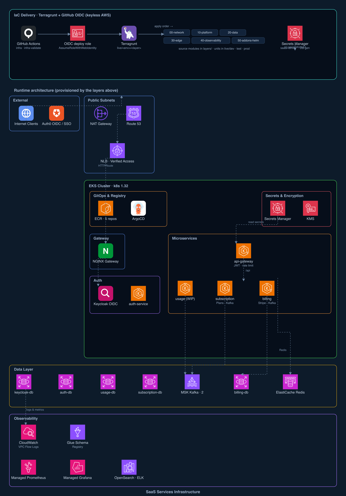

# saas-services-infra

> **Work in Progress** — This infrastructure is actively under development. Not all components are production-ready.

[](https://www.terraform.io/)
[](https://aws.amazon.com/)
[](https://kubernetes.io/)
[](./LICENSE)
[](https://github.com)

## Tags

`in-development` `terraform` `aws-infrastructure` `eks` `saas` `microservices`

Terraform + **Terragrunt** infrastructure for a multi-service SaaS platform on AWS. Provisions a full EKS-based environment with managed databases, messaging, observability, and auth — across `dev`, `test`, and `prod` environments, delivered keylessly via GitHub Actions OIDC.

---

## Architecture Overview



Delivered as **Terragrunt layers** (`live/<env>/00-network → 50-addons-helm`) sourcing the
modules in `layers/`, applied by GitHub Actions via keyless AWS **OIDC**. Application secrets
are generated (DB) or read from **Secrets Manager** — none are passed from CI.

**Services deployed to EKS:**
- `api-gateway` — JWT validation, rate limiting, Redis-backed session
- `auth-service` — Custom JWT auth (the alternative to Keycloak; see `auth_provider`)
- `subscription-service` — Plan management, Kafka events
- `billing-service` — Stripe integration, Kafka consumer
- `usage-service` — Usage tracking + RAG embedding (Airflow ETL jobs)
- `agent-service` — LLM agent; publishes token-usage events to Kafka

The developer portal (**Backstage**) and **Keycloak** are deployed from the CD repo;
this repo provisions their databases/secrets and ECR repos.

---

## Modules

Reusable building blocks in `modules/`, composed by the layers in `layers/`:

| Module | Description |
|--------|-------------|
| `modules/guardrails` | Per-environment security posture + tags (the `sizing`/`auth_provider`/`observability` policy engine every layer consumes) |
| `modules/eks` | EKS cluster, node group, IRSA roles |
| `modules/node-security-group` / `modules/data-security-groups` | Node + data-tier security groups |
| `modules/verified-access` | AWS Verified Access (Zero-Trust EKS API front door, prod) |
| `modules/k8s-and-helm` | Bootstraps ArgoCD + its App-of-Apps (Karpenter, cert-manager, external-dns, external-secrets, NGINX Gateway, Keycloak, SaaS apps) |
| `modules/rds` | PostgreSQL RDS instances (one per service); generates the master password → Secrets Manager |
| `modules/ecr` | Per-env ECR registry — one repo per service/function image, lifecycle policy + CMK (the `05-ecr` layer) |
| `modules/kms` | Reusable customer-managed KMS key (key + alias + policy); used by `05-ecr` and the `bootstrap` layer |
| `modules/elasticache` | Redis ElastiCache cluster |
| `modules/msk` | Amazon MSK (Kafka) |
| `modules/elk` | OpenSearch domain + IRSA for OTel collector |
| `modules/grafana` | Amazon Managed Grafana + Managed Prometheus |
| `modules/observability` | Observability facade — picks `elk` or `grafana` per env |
| `modules/otel` | OpenTelemetry Collector (K8s DaemonSet) |
| `modules/iam` | Shared IAM (VPC flow-log role, etc.) |
| `modules/gha-oidc` / `modules/bootstrap-ecr` | GitHub OIDC provider + scoped CI roles; the toolchain ECR repo (the `bootstrap` layer) |
| `modules/runner-vpc` / `modules/gha-runner` / `modules/runner-peering` | Isolated runner VPC; the self-hosted runner; peering to the app VPC for private EKS API reach (the `runner` layer) |
| `modules/ci-deployer-rbac` | The escalation-capable ci-deployer ClusterRole (the `45-rbac` layer) |

---

## Environments

Infrastructure is delivered with **Terragrunt** (env-by-directory). Each environment is a
directory under `live/<env>/` holding one thin unit per layer; shared identity lives in
`live/<env>/env.hcl` and the DRY backend/provider generation in `root.hcl`.

| Environment | Live tree | Auth | Observability | EKS Access |
|-------------|-----------|------|---------------|------------|
| `dev` | `live/dev/` | Keycloak | ELK | Public endpoint (CIDR-allowlisted) |
| `test` (staging tier) | `live/test/` | Keycloak | ELK | Private + AWS Verified Access |
| `prod` | `live/prod/` | Keycloak + Auth0 OIDC | ELK + Grafana | Private + AWS Verified Access |

> **Env naming:** the CD repo (`saas-continious-delivery`) calls the `test` tier **`staging`**
> (`dev` / `staging` / `prod`). The GitOps contract published from `20-data` carries the
> CD-facing name (`test` → `staging`) so the CD renderer writes the correct per-env paths.

### Auth Providers

Two auth strategies are supported via `auth_provider` (all current envs use `keycloak`):

- **`keycloak`** — Full Keycloak deployment on EKS; its DB credentials are backed by a
  dedicated RDS instance (prod points at the RDS directly, dev/staging run the in-cluster
  Postgres with those creds). Prod federates with Auth0 via OIDC.
- **`auth-service`** — Lightweight custom JWT service with its own RDS instance (the
  alternative; not currently selected by any env).

### Observability Stacks

Switchable via `observability`:

- **`elk`** — Amazon OpenSearch + OTel Collector → OpenSearch
- **`grafana`** — Amazon Managed Grafana + Managed Prometheus + OTel Collector

---

## Prerequisites

- Terraform `>= 1.3.0` (CI pins `~1.14.8`)
- Terragrunt `v1.1.0` (installed by CI via `.github/actions/setup-terragrunt`)
- AWS CLI configured with appropriate permissions
- `kubectl` and `helm` (for the addons/K8s layer)
- S3 bucket `saas-state-bucket-399849` (remote state backend, native S3 locking)

---

## Usage

Everything runs through the `Makefile`, which wraps Terragrunt. The layer numbers
encode apply order (`00-network` → `50-addons-helm`); services live in `live/services/`.

```bash
# Plan / apply one layer in one env
make plan  ENV=dev LAYER=00-network
make apply ENV=dev LAYER=00-network

# Whole stack, dependency-ordered
make plan-all  ENV=prod
make apply-all ENV=prod

# A single service (live/services/<env>/<svc>)
make svc-plan  ENV=test SERVICE=api-gateway
make svc-apply ENV=test SERVICE=api-gateway

# HCL-only checks (no cloud): fmt + render every unit with mocks
make fmt-check
make tg-render
make svc-render
```

CI never applies from a laptop for shared envs — see the workflows below. Secrets are
**not** passed on the command line; see [Secrets](#secrets--no-secret-is-passed-from-cigithub).

> **Standing up a new environment?** See [Provisioning a new environment
> (end-to-end)](#provisioning-a-new-environment-end-to-end) below for the full ordered
> flow, and the [bootstrap, runner & cluster-RBAC setup guide](docs/bootstrap.md) for
> commands and detail.

> **Tearing down an environment?** Run `scripts/teardown.sh <env>` **before** destroying.
> It deletes the cluster-created AWS resources Terraform doesn't manage — NLBs from
> `LoadBalancer` Services, Karpenter nodes, stale ENIs and LB security groups — empties the
> ECR repos and clears RDS deletion protection, so `make destroy-all ENV=<env>` (or
> `RUN_DESTROY=1 scripts/teardown.sh <env>`) completes without `DependencyViolation`. See
> [scripts/SCRIPT.md](scripts/SCRIPT.md#teardownsh--pre-destroy-cleanup).

---

## Provisioning a new environment (end-to-end)

Layers fall into two groups: the **CI substrate** (`bootstrap`, `runner`, `45-rbac`) is
applied out-of-band and is *not* in `infra.yml`; the **steady-state stack**
(`00-network … 50-addons-helm`) is driven by `infra.yml`. Weaving through both is secret
handling, which comes in **three kinds** (see [Secrets](#secrets--no-secret-is-passed-from-cigithub)):
*Terraform-generated* (DB passwords, in `20-data`), *out-of-band seeded* (step 2 below,
via SOPS + `seed-secrets.sh`), and *in-cluster generated* (the runner's token; optionally
Backstage's). Detail and commands: [bootstrap, runner & cluster-RBAC setup guide](docs/bootstrap.md).

```
[GitHub App: SAAS-infra-bot]            [age key → secrets.<env>.enc.env]     (one-time)
        │ id/inst ─► runner                     │ seed-secrets.sh ─► Secrets Manager
        │ key ─► Secrets Manager                ▼ (must land before 30-edge / 40-obs / services)
        ▼
bootstrap ─► seed-secrets ─┬─► 00-network ─► 10-platform ─┬─► 20-data ─► 30-edge ─► 40-observability ─► 50-addons-helm
           │               │                 (gen DB pw)  │                                             (self-hosted + toolchain)
           └───── runner ──┘                              └─► 45-rbac  (cluster-bootstrap.yml, scope: full-layer)
```

| # | Step | Applied by | Why / gate |
|---|------|-----------|------------|
| 0 | **One-time prerequisites** | Org owner / laptop | Create the **`SAAS-infra-bot` GitHub App** (repo *Administration: read/write*); note **App ID** + **Installation ID** and download the **private key** (PEM) — these feed step 4 ([inputs](#the-runners-github-app-step-4-inputs)). Generate an **age key** for SOPS and author `secrets.<env>.enc.env` ([Secrets](#secrets--no-secret-is-passed-from-cigithub)) — feeds step 2. |
| 1 | **`bootstrap`** | Admin, laptop (`make apply`) | No deps. Creates ECR toolchain repo + OIDC `tf-plan`/`tf-apply`/`cluster-bootstrap` roles + CMK. Then run the **`bootstrap-image`** workflow and wire `AWS_DEPLOY_ROLE_ARN` / `AWS_ROLE_CLUSTER_BOOTSTRAP` / `BOOTSTRAP_IMAGE`. |
| 2 | **Seed out-of-band secrets** (`./scripts/seed-secrets.sh <env>`) | Admin, laptop (SOPS/age decrypt) | Only needs step 1 (AWS creds + Secrets Manager). Writes `stripe-api-key`, `auth-jwt`, `opensearch-master`, `auth0`, `llm-api-keys`, `backstage-input` to Secrets Manager. **Must run before step 6** — `30-edge` reads `auth0`, `40-observability` reads `opensearch-master`, and the services read the rest. |
| 3 | **`00-network`**, **`10-platform`** | `infra.yml` → `tf-apply` (OIDC, `ubuntu-latest`) | Standard stack. `10-platform` grants the **gated `cluster-bootstrap` role** a cluster-admin access entry (`cluster_admin_principal_arns`, from `bootstrap`); the `tf-apply` caller is **not** admin (`include_caller_as_cluster_admin = false`). |
| 4 | **`runner`** | Admin, laptop (`make apply` + `make register-runner`) | Needs `bootstrap` + `00-network` + `10-platform`. Stands up the isolated runner VPC + self-hosted runner, peered to the app VPC so it reaches the **private** EKS API. Registration auth is the **`SAAS-infra-bot` GitHub App** (repo-scoped, no user PAT): pass its id/installation id via env, apply, then `make register-runner` to seed the App private key + cycle the ASG so the host registers as `[self-hosted, vpc]`. |
| 5 | **`45-rbac`** | **`cluster-bootstrap.yml`**, `scope: full-layer` → gated role, on the in-VPC runner | Needs `10-platform` + `bootstrap`. The ci-deployer RBAC holds `bind`/`escalate`, so first creation needs cluster-admin — the gated role already has it (step 3), so the only human action is approving the protected-Environment deployment. This maps `tf-apply` → `ci-deployers`. Recovery later: same workflow, `scope: rbac-only`. |
| 6 | **`20-data … 50-addons-helm`** | `infra.yml` → `tf-apply` | `tf-apply` now acts cluster-side as `ci-deployers` (never admin). `20-data` **generates** the DB passwords and publishes the GitOps contract; `30-edge`/`40-observability` **read** the step-2 secrets. |
| 7 | **services + Backstage** | services tree / Argo CD | Services read their seeded secrets. Backstage's Keycloak client secret + Argo CD token are **generated in-cluster** when `secretGeneration.enabled` (then dropped from `backstage-input`). |

Key points:

- **Seed (step 2) before step 6.** `30-edge` (Auth0) and `40-observability` (OpenSearch),
  and the services, fail if their Secrets Manager entries aren't present yet. Seeding only
  depends on `bootstrap`, so do it as soon as that's applied.
- **`45-rbac` must precede `50-addons-helm`** — it's the hinge. Before it runs, `tf-apply`
  has no cluster permissions; after it, `tf-apply` reconciles as `ci-deployers`. Among the
  `infra.yml` layers, `50-addons-helm` is the only one that talks to the cluster.
- **No human is ever cluster-admin on the box.** The sole cluster-admin principal is the
  gated `cluster-bootstrap` role, assumable only through an approved deployment to the
  protected GitHub Environment. `make apply LAYER=45-rbac` remains a break-glass path.
- **Cluster reachability:** `50-addons-helm` is the only `infra.yml` layer with helm/kubectl
  providers, so it runs on the in-VPC `[self-hosted, vpc]` runner inside the toolchain image
  (`run_in_toolchain`), the only path to a **private** EKS endpoint. Every other layer stays
  on GitHub-hosted runners. This is why `45-rbac` (step 5) must land first — it maps `tf-apply`
  to `ci-deployers`, the identity that layer then runs as.

`make apply-all ENV=<env>` resolves the steady-state DAG via `terragrunt run --all`; the
CI-substrate layers are applied by the steps above, not by `apply-all`.

### The runner's GitHub App (step 4 inputs)

The runner registers via the **`SAAS-infra-bot`** GitHub App (repo permission
*Administration: read/write*), not a user PAT — at boot it mints a short-lived
registration token, so no long-lived runner credential is stored. You supply three things:

| Value | Secret? | How it's passed |
|---|---|---|
| App ID | no | `export GHA_RUNNER_APP_ID=<id>` (read from the App's *About* page) → `runner.hcl` `get_env` → layer input |
| Installation ID | no | `export GHA_RUNNER_APP_INSTALLATION_ID=<id>` (from the `…/settings/installations/<id>` URL) → same path |
| Private key (PEM) | **yes** | seeded once into Secrets Manager by `make register-runner` — never passed through Terraform/state |

So id + installation id are **Terragrunt inputs via env**; the user-data template receives
them through `templatefile()` and only the private key is a secret. Full lifecycle
(boot-time token exchange, ASG self-healing, rotation, troubleshooting):
[docs/runner-registration.md](docs/runner-registration.md).

### Docs for this flow

- [docs/bootstrap.md](docs/bootstrap.md) — bootstrap / runner / 45-rbac operational guide.
- [docs/runner-registration.md](docs/runner-registration.md) — runner GitHub App auth, ASG, key rotation.
- [docs/apply-layer-workflow.md](docs/apply-layer-workflow.md) — how `_apply-layer.yml` applies each layer (incl. the self-hosted `50-addons-helm`).

---

## ECR Repositories

The **`05-ecr`** layer owns one ECR registry per environment (dedicated CMK, scan-on-push,
immutable tags), independent of the VPC/cluster lifecycle. One repo per service image:

- `api-gateway`, `auth-service`, `subscription-service`, `billing-service`,
  `usage-service`, `agent-service`, `backstage-saas`

plus the Crossplane composition-function packages (`function-appdatabase`,
`function-appcache`) and an auto-created `helm/<chart>` repo per chart the CD ApplicationSet
pushes (`oci://<registry>/helm`). The one-time CI **toolchain** image lives in a separate
repo — `saas-<env>-bootstrap-runner` (the `bootstrap` layer).

---

## Security

- EKS secrets encrypted with a dedicated KMS key
- All RDS instances encrypted at rest (KMS)
- MSK encryption in transit and at rest (KMS)
- ElastiCache encrypted at rest (KMS)
- ECR images scanned on push
- IMDSv2 enforced on EKS nodes
- VPC Flow Logs → CloudWatch
- EKS control plane logs: `api`, `audit`, `authenticator`, `controllerManager`, `scheduler`
- Prod: private EKS API endpoint + AWS Verified Access (Zero Trust)
- Least-privilege cluster access: the sole cluster-admin is the **gated `cluster-bootstrap`
  role** (assumable only via an approved protected-Environment deployment); `10-platform`
  sets `include_caller_as_cluster_admin = false` so the steady-state `tf-apply` role is
  never admin — it acts cluster-side only as the scoped `ci-deployers` group, whose RBAC is
  broadened to exactly the platform install-target namespaces (`argocd`, `nginx-gateway`,
  `monitoring`, `kube-system`) plus the needed cluster objects — not cluster-admin
- Self-hosted runner auth via the `SAAS-infra-bot` **GitHub App** (short-lived registration
  tokens, no long-lived PAT); the runner host holds no deploy/cluster rights — jobs federate
  GitHub OIDC into scoped roles

### Secrets — no secret is passed from CI/GitHub

Terraform receives **zero** application secrets as `TF_VAR_*` from GitHub. Two patterns:

- **Database master passwords** are *generated* by `modules/rds` (`password = null` in
  `layers/20-data`) and written to Secrets Manager as `{username,password,endpoint,db_name}`;
  the service roots read them back by ARN. No human ever handles them.
- **Third-party / app secrets** are seeded **out-of-band** into Secrets Manager and *read*
  by the config via `data "aws_secretsmanager_secret_version"`. The deploy role
  (`AWS_DEPLOY_ROLE_ARN`) needs `secretsmanager:GetSecretValue` (it has it — Admin).

| Secret (Secrets Manager id)     | Shape                              | Read by |
| ------------------------------- | ---------------------------------- | ------- |
| `saas/<env>/stripe-api-key`     | plain string                       | billing-service |
| `saas/<env>/auth-jwt`           | `{secret, refresh_secret}`         | auth-service |
| `saas/<env>/opensearch-master`  | `{username, password}`             | 40-observability, 50-addons-helm (elk only) |
| `saas/<env>/auth0`              | `{client_id, client_secret}`       | 30-edge (Verified Access, test + prod) |
| `saas/api-gateway-input`        | `{JWT_SECRET}` (pre-existing)      | api-gateway |
| `saas/backstage-input`          | `{GITHUB_TOKEN, ARGOCD_AUTH_TOKEN, KEYCLOAK_CLIENT_SECRET}` | `backstage/` module (composed → `backstage-app`) |
| `saas/<env>/llm-api-keys`       | `{OPENAI_API_KEY, ANTHROPIC_API_KEY}` | usage-service (RAG embedding), agent-service |

The `backstage/` module composes the seeded `saas/backstage-input` plus a generated backend
key and the derived Keycloak discovery URL into the **`backstage-app`** secret that the CD
repo's ExternalSecret reads (the Backstage DB half is a separate `modules/rds` secret).

> **Wiring Auth0 to the EKS API front door?** See
> [docs/verified-access-auth0.md](docs/verified-access-auth0.md) for the end-to-end
> Verified Access ⟷ Auth0 OIDC setup runbook.

Seed them once per environment. The source of truth is a **SOPS/age-encrypted**
`secrets.<env>.enc.env` committed to the repo (versioned + reviewable, no plaintext in
git); `seed-secrets.sh` decrypts it in memory and writes the values to Secrets Manager:

```bash
# one-time: generate an age key and put its PUBLIC line in .sops.yaml
age-keygen -o ~/.config/sops/age/keys.txt

# edit/create the encrypted env file (opens $EDITOR, re-encrypts on save)
sops secrets.prod.enc.env          # lines: TF_VAR_stripe_api_key=sk_live_…

# seed (decrypts with your age key; create-or-update; values never printed)
./scripts/seed-secrets.sh prod
```

age — not KMS — is used so the committed file carries only a public recipient, never an
AWS account id (matching this repo's no-committed-account-id convention). The script
falls back to a local, gitignored plaintext `secrets.<env>.env` if no encrypted file is
present, so nothing breaks mid-migration.

`saas/backstage-input` is **account-global** (no `<env>` in the id) — seed it only from the
env file that carries the backstage values; the script guards it so a run for another env
won't clobber it with empty fields. The self-hosted runner's GitHub App key
(`saas-<env>-gha-runner-app-key`) is **not** seeded here — it's handled by
`make register-runner` (see [runner-registration.md](docs/runner-registration.md)).

After seeding, **delete these repo/environment GitHub secrets** (now unused):
`TF_VAR_KEYCLOAK_DB_PASSWORD`, `TF_VAR_SUBSCRIPTION_DB_PASSWORD`, `TF_VAR_BILLING_DB_PASSWORD`,
`TF_VAR_USAGE_DB_PASSWORD`, `TF_VAR_AUTH_DB_PASSWORD`, `TF_VAR_OPENSEARCH_MASTER_PASSWORD`,
`TF_VAR_OPENAI_API_KEY` (was undeclared — silently ignored), `TF_VAR_AVA_OIDC_CLIENT_ID`,
`TF_VAR_AVA_OIDC_CLIENT_SECRET`, `TF_VAR_AUTH_JWT_SECRET`, `TF_VAR_AUTH_JWT_REFRESH_SECRET`,
`TF_VAR_KEYCLOAK_JWKS_URL`, `TF_VAR_GATEWAY_JWT_SECRET`, `TF_VAR_STRIPE_API_KEY`.
Only `AWS_DEPLOY_ROLE_ARN` and `INFRACOST_API_KEY` remain.

---

## Policy as Code

Terraform passes through **three guardrail layers** before it reaches AWS — in CI
on every PR ([`.github/workflows/infra-validate.yml`](.github/workflows/infra-validate.yml))
and again as the enforced Atlantis apply gate. See [`policy/README.md`](policy/README.md).

| Layer | Tool | Catches |
|---|---|---|
| Lint | `tflint` (+ AWS ruleset) | Provider misuse, deprecated syntax, bad instance types, naming |
| Security scan | `checkov` | ~1k CIS/AWS benchmarks over HCL + plan |
| Strict PAC | OPA/Rego via `conftest` | Org rules on the *plan*: encryption, public exposure, admin-port CIDRs, IAM `*:*`, tagging |

```bash
make guardrails    # lint + checkov + policy-test (hermetic, no cloud creds)
make policy        # plan -> show -json -> conftest test (needs AWS creds)
```

**Atlantis** runs the same Rego set natively: with `--enable-policy-checks`, a
`policy_check` stage evaluates every plan and blocks apply on a `deny` until a
policy owner runs `atlantis approve_policies`. Config is version-controlled at
[`atlantis/repos.yaml`](atlantis/repos.yaml) — see [`ATLANTIS.md`](ATLANTIS.md#policy-checks-guardrails).

## Cost estimation

Every infra PR also gets a cloud-cost estimate from
[Infracost](https://www.infracost.io/) — informational, it never gates a merge.

- **CI** ([`.github/workflows/infracost.yml`](.github/workflows/infracost.yml)):
  plans the cost-bearing `test` layers, reads each plan JSON, and posts one
  combined cost comment on the PR.
- **Atlantis**: the `terragrunt` plan workflow appends an `infracost breakdown`
  table to each plan comment (see [`ATLANTIS.md`](ATLANTIS.md#required-environment-on-the-atlantis-server)).

```bash
make infracost     ENV=prod LAYER=20-data   # one unit
make infracost-all ENV=prod                 # all cost-bearing layers
```

Both need `INFRACOST_API_KEY` (free, from `infracost auth login`). CI also needs
it as a repo secret alongside `AWS_DEPLOY_ROLE_ARN`.

---

## State Backend

Remote state is stored in S3 with native locking:

```hcl
backend "s3" {
  bucket       = "saas-state-bucket-399849"
  key          = "saas-services/terraform.tfstate"
  region       = "us-east-1"
  use_lockfile = true
  encrypt      = true
}
```

---

## Project Status

> This project is under active development. The following areas are still being worked on:

- [ ] Usage service infrastructure (RDS provisioned, service Helm chart pending)
- [ ] Airflow DAGs and production configuration
- [ ] Stage environment parity with prod
- [x] CI/CD pipeline integration
- [x] Cost estimation on PRs (Infracost — CI + Atlantis)
- [ ] Disaster recovery / backup policies
- [x] Secure password protection for RDS (generated by `modules/rds` → Secrets Manager; never in CI)
- [x] Loose coupling of service credentials from the infra state (secrets read from Secrets Manager, `saas/<env>/*`)

---

## Repository Structure

Terragrunt drives everything: `layers/` and the service dirs are the **source modules**;
`live/<env>/` are the thin per-environment units that set `inputs` and are wired together
by dependency blocks. `root.hcl` generates the S3 backend + base AWS provider for all units.

```
.
├── root.hcl                     # DRY core: remote_state (S3 + lock) + generated aws provider
├── Makefile                     # plan/apply/render/fmt wrappers over terragrunt
│
├── layers/                      # Source modules, numbered by apply order
│   ├── 00-network/              # VPC, subnets, NAT, Route53, Glue Schema Registry
│   ├── 05-ecr/                  # Per-env ECR registry (service + Crossplane-function repos)
│   ├── 10-platform/             # EKS cluster + node groups
│   ├── 20-data/                 # RDS (per service), ElastiCache Redis, MSK Kafka
│   ├── 30-edge/                 # NLB + AWS Verified Access (prod Zero-Trust)
│   ├── 40-observability/        # OpenSearch (elk) / Managed Grafana+Prometheus
│   ├── 45-rbac/                 # EKS access entries + ci-deployer RBAC (one-time)
│   ├── 50-addons-helm/          # Helm addons: NGINX, ArgoCD, Keycloak, OTel, ...
│   ├── bootstrap/               # One-time CI identity: ECR + OIDC roles (no deps)
│   └── runner/                  # One-time: isolated runner VPC + self-hosted runner
│
├── live/                        # Terragrunt units (env-by-directory)
│   ├── _envcommon/              # Shared per-layer config (deps, mock_outputs)
│   ├── dev/  test/  prod/       # <env>/<layer>/terragrunt.hcl  (+ env.hcl)
│   └── services/                # App services, per env
│       ├── _envcommon/          # Shared per-service config
│       └── test/  prod/         # <env>/<service>/terragrunt.hcl
│
├── api-gateway/  auth-service/  billing-service/  subscription-service/
│   usage-service/  backstage/   # Service source modules — compose each service's
│                                # app secret in Secrets Manager (read by CD ExternalSecrets)
│
├── modules/                     # Reusable modules (see Modules table)
│
├── policy/                      # Policy-as-Code
│   ├── opa/  terraform/         # Rego (Conftest) — plan-level guardrails
│   └── checkov/                 # Custom Checkov checks
│
├── .github/
│   ├── workflows/               # infra (+ _apply-layer), infra-validate, infracost,
│   │                            # cluster-bootstrap, dependabot-auto-merge
│   └── actions/setup-terragrunt # Pinned terragrunt installer
│
├── atlantis/  atlantis.yaml     # Atlantis (enforced apply gate) config
├── migration/                   # One-shot scripts that moved the flat root → layers
├── scripts/                     # seed-secrets, verify-apply, apply-stepwise,
│                                # teardown (pre-destroy cleanup) — see scripts/SCRIPT.md
├── secrets.dev.env  secrets.prod.env   # gitignored — local source for seed-secrets.sh
├── architecture.svg / .png      # Architecture + Terragrunt delivery diagram (SVG = editable source)
└── graph.png                    # Terraform dependency graph
```
